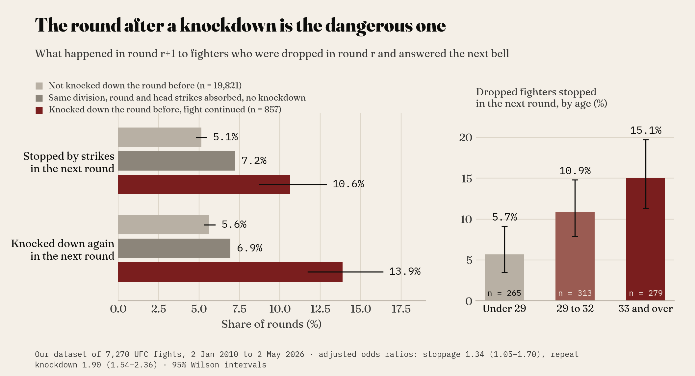
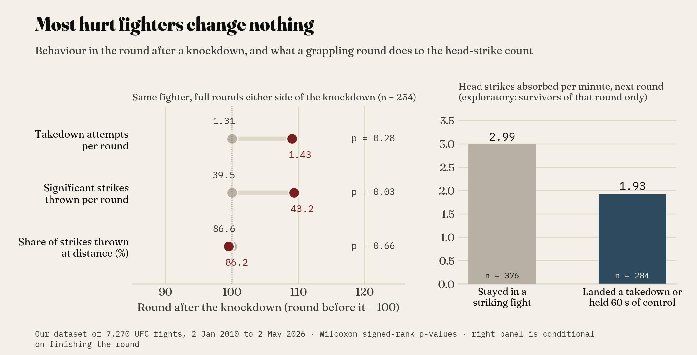
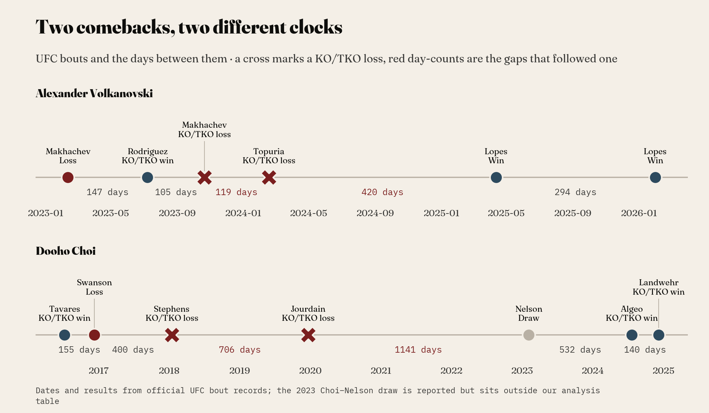
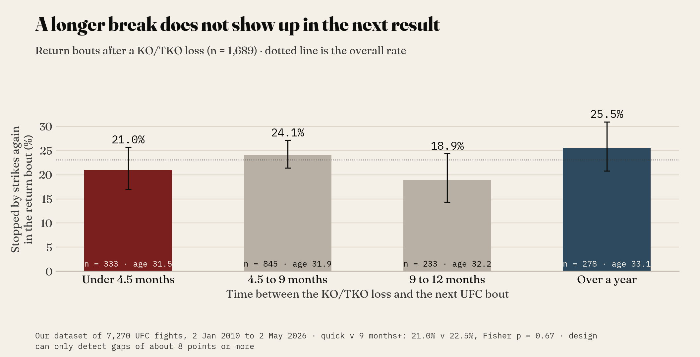
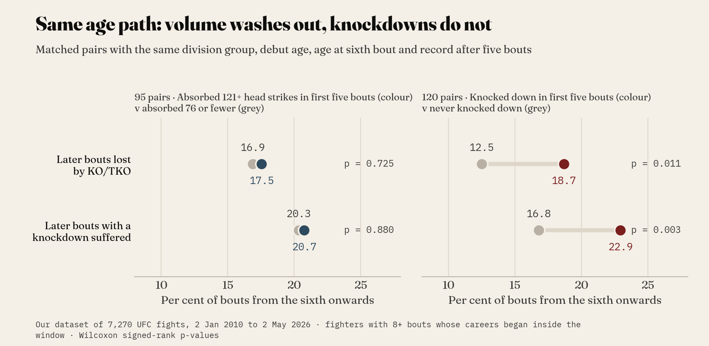

# After the Knockdown

*A fighter has just been dropped. What should happen in the next round, and at the next booking? We put both questions to our dataset of 7,270 UFC fights from 2 January 2010 to 2 May 2026.*

Late in the second round at UFC 318, on 19 July 2025, Dustin Poirier caught Max Holloway with a right hand behind the ear. Sherdog's play-by-play has Holloway going down, Poirier jumping on a guillotine, the horn arriving before he could finish it, and Holloway wobbling "back to his corner". The official statistics credit Poirier with the knockdown. They also show what came next. Holloway out-landed him 38–21, 44–22 and 46–25 across the last three rounds and took a unanimous decision.

A corner with sixty seconds on the clock needs the base rate, and that fight was not it: what usually happens to a fighter who has just been dropped, and can he do anything about it? The same question returns a few weeks later in slower form. How long should a knocked-out fighter stay away?

## Why a knockdown is a different kind of number

Most head strikes leave nothing on the record beyond a tally. When a fighter's legs go, a blow has briefly interrupted the brain's control of posture and balance, usually through a sharp rotation of the head from a shot to the jaw, the temple or behind the ear. It is the closest thing official statistics have to a record of acute brain disturbance.

What no statistic can record is the chronic side. Chronic traumatic encephalopathy (CTE), in the words of Boston University's CTE Center, "can only be diagnosed after death", so nothing here diagnoses anyone. The narrower question is whether the visible event changes what follows in the cage.

A hurt fighter has four options: shell up, give ground, tie up, or change levels and shoot. Coaches drill the last two because they take away the space a finishing punch needs. Whether fighters use them is something the record can check.

## The next round

In our dataset, fighters were knocked down in 2,869 fighter-rounds. In 57 per cent of those the fight was stopped before the horn. In 857 of them, spread across 795 fights, the dropped fighter came out for another round.

Those fighters were stopped by strikes in the very next round 10.6 per cent of the time, against 5.1 per cent for fighters who had not been dropped. They were knocked down again 13.9 per cent of the time, against 5.6 (chi-square, both *p* < 0.001). Only 34 per cent went on to win the fight.

Part of that gap belongs to the beating and not to the knockdown, since a fighter who gets dropped is usually losing the round anyway. So I compared like with like: same round, same division group and the same number of head strikes absorbed, but no knockdown. That group is stopped 7.2 per cent of the time and dropped 6.9 per cent. A logistic regression holding the round's head strikes, the striking deficit, age, round number and weight class constant still gives the knockdown an odds ratio of 1.90 for a repeat knockdown (95 per cent interval 1.54 to 2.36) and 1.34 for a stoppage (1.05 to 1.70). The first survives a correction for multiple testing. The second does not, so read 1.34 as suggestive.

One detail matters for coaches. Once the previous round is accounted for, dropped fighters absorb slightly *fewer* head strikes per minute than expected in the next round (0.46 fewer, *p* < 0.001). They are not being hit more. The same shots are putting them down more often.

Age sharpens everything. Dropped fighters under 29 were stopped in the next round 5.7 per cent of the time. At 33 and over it was 15.1 per cent (trend *p* < 0.001, which survives correction). Age keeps its effect with that round's punishment held constant, at an odds ratio of 1.09 per year (1.03 to 1.16), while the count of earlier knockdowns on a fighter's record adds nothing once age is in the model.

## What hurt fighters actually do

Here the record parts company with the coaching manual. For 254 knockdowns with a full round on either side, I compared each fighter's behaviour in the round before he was dropped with the round after it.

Takedown attempts barely move, from 1.31 to 1.43 per round (Wilcoxon signed-rank *p* = 0.28). The share of strikes thrown at distance is unchanged at 86.6 against 86.2 per cent. The one shift is volume: 39.5 strikes thrown becomes 43.2 (*p* = 0.03, which does not survive correction). Hurt fighters mostly fight the same fight, a little busier.

Does having a wrestling game help? I classed fighters by takedown attempts per 15 minutes in their *previous* bouts only, so the label is fixed before the fight starts. Dropped fighters with a wrestling habit were stopped in the next round 11.3 per cent of the time and dropped strikers 14.1 per cent. The difference is nowhere near significant (interaction *p* = 0.77).

One exploratory number points the other way, and it needs its caveat attached. Among the 660 dropped fighters who completed the next round, those who landed a takedown or held a minute of control absorbed 1.93 head strikes per minute, against 2.99 for those who stayed in a striking fight, and they won 48 per cent of the time against 19. A fighter who can secure a minute of control was probably less hurt to begin with, however, and anyone finished early never had the chance to grapple. The figure describes a grappling round. It does not prove that choosing one works.

## The next booking

Alexander Volkanovski took the UFC 294 rematch with Islam Makhachev in October 2023 on 11 days' notice and was knocked out by a head kick. He was back 119 days later and Ilia Topuria knocked him out again. He then sat out 420 days, returned at 36 and won the vacant featherweight title from Diego Lopes, getting up from a second-round knockdown on the way. Dooho Choi's clock ran differently. Stopped by Jeremy Stephens in January 2018, he waited 706 days and was stopped again by Charles Jourdain, going down twice. More than three years passed before a draw with Kyle Nelson, and then came TKO wins over Bill Algeo and Nate Landwehr in 2024.

Either career can be told as proof that rest works, or that it does not. So I took all 1,689 return bouts that followed a KO/TKO loss.

Fighters who returned inside four and a half months were stopped again 21.0 per cent of the time. Those who waited nine months or more were stopped 22.5 per cent of the time (Fisher's exact *p* = 0.67). Restricting to stoppages that included a knockdown changes nothing (21.6 against 23.1 per cent). After adjusting for age, division, earlier stoppages and the opponent's knockdown power, a long break carries an odds ratio of 0.91 (0.69 to 1.18).

Two qualifications belong beside that result. The comparison can only detect gaps of about eight percentage points, so a modest benefit could hide inside it. Breaks are also not handed out at random: the over-a-year group averages 33.1 years old against 31.5 for the quick returners, and a long absence often means surgery or an especially bad knockout. None of this says rest does nothing for the brain. It says the next result is a poor instrument for seeing it.

## The career

Over a career the pattern repeats. Cumulative head strikes absorbed correlate with losing until age is removed, at which point the correlation is −0.001 (*p* = 0.92). To make that concrete I paired fighters who walked the same age path, with the same division group, a debut age and an age at sixth bout within 18 months of each other, and an identical record after five bouts.

Ninety-five pairs differed threefold in early head strikes absorbed (165 against 54). From the sixth bout on they were stopped at the same rate, 17.5 against 16.9 per cent. Another 120 pairs had the same early dose (99 head strikes each) and similar hit rates, and differed only in that one fighter had been knocked down in his first five bouts. He was later stopped in 18.7 per cent of bouts against his partner's 12.5 (Wilcoxon *p* = 0.011, bootstrap interval for the gap 2.0 to 10.5 points) and knocked down in 22.9 per cent against 16.8 (*p* = 0.003, which survives correction). The gap did not widen with age (*p* = 0.27). He sits on a lower curve with the same slope.

Is that injury, or were some chins never as good? One comparison leans towards the event itself. Fighters whose first UFC loss was a knockout were stopped again sooner than those whose first loss was a submission (log-rank *p* < 0.001, 456 and 288 fighters). Yet among fighters who had already won in the UFC before that first loss, the two curves are indistinguishable (*p* = 0.95). I cannot reconcile those two results cleanly.

## What a corner can take from it

What our dataset shows: the round after a knockdown carries about double the usual risk, the risk climbs steeply with age, most fighters change nothing, a longer layoff does not show up in the next result, and knockdowns mark what follows where strike totals do not. The rest is interpretation, to be tested in the gym.

**Agree a dropped protocol in camp.** A hurt fighter should not be inventing a plan on the stool. One reasonable version: for the first 90 seconds of the next round, no exchanges in the pocket. Clinch, change levels or circle to open space until the legs are back.

**Do not swing back.** Volume goes up after a knockdown. Trading more, at the moment the same shot is likelier to put you down, is the worst available answer.

**Let age set the threshold.** At 33 and over, a dropped fighter is stopped in the next round about one time in seven. That is the moment for an honest assessment on the stool.

**Count knockdowns, not strikes absorbed.** For matchmaking and for a fighter's own career planning, an early knockdown is the marker that carries forward for years.

**Set the return date on medical advice.** The record offers no performance argument either way.

*Film-study question.* Pull five fights in which your fighter was dropped and survived. In the first 90 seconds of the next round, count pocket exchanges, clinch entries and level changes, then do the same for the round before the knockdown. Did anything change?

*Controlled drill.* With no head contact at any stage: 30 seconds of balance disruption (spins into sprawls), then a two-minute round against a pressuring partner wearing body armour. The only permitted answers are a clinch entry, a takedown attempt or an exit to open space. The coach counts pocket exchanges, and the target is zero.

---

### Methods note

**Data.** Our dataset of 7,270 UFC fights runs from 2 January 2010 to 2 May 2026 (631 events) and holds official bout and round statistics: 35,218 fighter-rounds with strikes by target and position, takedowns, control time and knockdowns. It excludes 140 listed bouts that ended in a draw, a no-contest or an overturned result, so coverage is 98 per cent of listed bouts and not complete. Layoffs were measured from the full bout list, including those 140, so an excluded bout cannot inflate a gap.

**Verification.** No duplicate fights or fighter-rounds; exactly two rows per round; no missing values in the fields used; three fighters lack a date of birth. Round totals summed by fighter match the bout-level totals for knockdowns, significant strikes, head strikes and takedowns in all 7,270 fights, which confirms fighter and opponent alignment. The UFC 318 round record was checked against a published play-by-play, and the Volkanovski and Choi dates, results and layoffs against news reports and the full bout list.

**Leakage.** Every career exposure (cumulative head strikes, knockdowns, stoppages, takedown habit) counts previous bouts only. Next-round outcomes use only information from the round in question and earlier. The 389 fighters whose listed careers began before 2010 are excluded from career analyses because their early exposure is unobserved.

**Tests.** Chi-square and Fisher's exact tests for rates; Cochran–Armitage trend tests; logistic regressions with standard errors clustered by fight or fighter; Wilcoxon signed-rank and paired *t*-tests for within-fighter and matched-pair contrasts, with bootstrap intervals (2,000 resamples); optimal one-to-one matching with calipers of 1.5 years on both age variables, an exact match on early record and, for the knockdown contrast, 0.5 head strikes per minute on hit rate; partial Spearman correlation; log-rank tests. Wilson intervals on charts. A Holm correction was applied across 22 headline tests, and the text says where a result does not survive it.

**Limits.** Round totals carry no timestamps, so the order of events inside a round is unknown and the grappling comparison is conditional on finishing the round. KO/TKO includes stoppages from ground strikes, body shots, leg kicks and doctors. Official knockdowns are a scorer's judgement. Sparring and non-UFC bouts are invisible. Fighters who decline sharply are released, so long careers over-represent the durable. Only a fighter's UFC record is observed, and no medical, imaging or cognitive outcome was available. Group averages here describe the record and are not forecasts for any individual fighter.

### Sources

- [Sherdog: UFC 318 'Holloway vs. Poirier 3' play-by-play, results and round scoring](https://www.sherdog.com/news/news/UFC-318-Holloway-vs-Poirier-3-PlaybyPlay-Results-Round-Scoring-197746)
- [UFC Stats: Holloway vs. Poirier 3 official bout statistics](http://ufcstats.com/fight-details/d7507e2741fd4d05)
- [Al Jazeera: Poirier loses to Holloway in UFC 318 retirement fight](https://www.aljazeera.com/sports/2025/7/20/poirier-loses-to-holloway-in-ufc-318-retirement-fight)
- [ESPN: Volkanovski's 11-day preparation for Makhachev at UFC 294](https://www.espn.com/mma/ufc/story/_/id/38647640/ufc-294-volkanovski-promises-absolute-nightmare-makhachev-11-day-preparation)
- [Forbes: Makhachev scores head-kick KO over Volkanovski at UFC 294](https://www.forbes.com/sites/brianmazique/2023/10/21/ufc-294-results-makhachev-scores-head-kick-ko-over-volkanovski-watch/)
- [ESPN: Volkanovski wins vacant title in slugfest with Lopes at UFC 314](https://www.espn.com/mma/story/_/id/44651940/volkanovski-wins-vacant-title-slugfest-lopes-ufc-314)
- [Inquirer Sports: Volkanovski reclaims featherweight belt at UFC 314](https://sports.inquirer.net/619142/ufc-314-volkanovski-reclaims-featherweight-belt-beats-lopes)
- [Cageside Press: Doo Ho Choi TKOs Algeo](https://cagesidepress.com/2024/07/20/doo-ho-choi-tkos-algeo-emotional-after-win/)
- [Wikipedia: Choi Doo-ho, UFC record and dates](https://en.wikipedia.org/wiki/Choi_Doo-ho)
- [Boston University CTE Center: Frequently asked questions](https://www.bu.edu/cte/about/frequently-asked-questions/)
